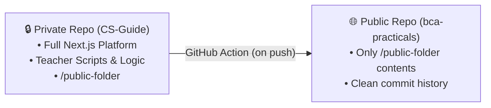

# ok read this workspace and tell me

*Saved on: 17/10/2026, 10:57:51 pm*
*Conversation ID: 77e14b44-1e59-4b0a-b919-08989624f33a*

---

### 👤 User

ok read this workspace and tell me

---

### 🤖 Antigravity AI

Here is a complete overview of your active workspaces under `Nextsem Repositories`:

---

### 📂 Workspace Overview (3 Active Repositories)

| Workspace Directory | Primary Role & Tech Stack | Current Status / Milestone |
| :--- | :--- | :--- |
| **`CS-Guide`**<br>`c:\Users\Manoj\Nextsem Repositories\CS-Guide` | **BCA Practical Learning Portal & IGNOU BCA Hub**<br>• Next.js 16.2.9 + React 19 + Tailwind CSS v4<br>• Capacitor 8 (Android/iOS) + Firebase 12 | **Phase 1 Complete (Days 1–30 ✅)**<br>• Student Auth & Progress Persistence deployed<br>• Ready for **Days 31–40** (Advanced JS & APIs) |
| **`ncert.nextsem.online`**<br>`c:\Users\Manoj\Nextsem Repositories\ncert.nextsem.online` | **StudyGuide by Nextsem (NCERT & NIOS Hub)**<br>• Vite 8 + React 19 + TypeScript<br>• Capacitor 8.5 + Firebase Hosting | **Phase 3 Active** (21 Done ✅, 8 Pending ⏳)<br>• 79 Labs & 8 React Suites active<br>• Class 1–12 + NIOS bilingual bank |
| **`bca`**<br>`c:\Users\Manoj\Nextsem Repositories\bca` | **BCA Practical Coursework / Exercise Repo**<br>• Vanilla HTML/CSS/JS Project Suites | Contains `bca-day-01` through `bca-day-07` daily practical project code & assets |

---

### 1️⃣ `CS-Guide` — Live Metrics & Roadmap Status

*Authored by Er. Manoj Kumar*

- **3-Year Master Degree Structure**: 6 Semesters • 360 Practical Days across 4 Career Tracks (*Web/Full-Stack, Software/DSA, Data/AI, IT/Cloud*).
- **Current Completion Metrics**:
  - **Days 01–10**: Complete & Verified ✅ *(HTML5 Semantic Boilerplate to CSS)*
  - **Days 11–20**: Complete & Verified ✅ *(CSS Box Model, Flexbox, Grid, Responsive Mini Project)*
  - **Days 21–30**: Complete & Verified ✅ *(JavaScript Essentials: Variables, Functions, DOM, Events)*
  - **Coding Tasks with Regex Validators**: 59
  - **Spot-the-Bug Challenges / Viva Checks / GitHub Workflows**: 31 each
  - **Phase 2 Student Infrastructure**: Google Auth, scoped Firestore/localStorage sync (0ms instant hydration), GitHub Profile linking, and Student Dashboard Modal are fully implemented.
- **Local Dev Server Endpoint**: `http://localhost:3001/` (Stopped ⚪ — run `npm run dev`)
- **Active Task File**: [task.md](file:///c:/Users/Manoj/Nextsem%20Repositories/CS-Guide/docs/roadmap/task.md)
- 👉 **Immediate Next Step**:
  > **Author & integrate Days 31–40 of Semester 1** in [`bcaPracticalData.ts`](file:///c:/Users/Manoj/Nextsem%20Repositories/CS-Guide/src/data/bcaPracticalData.ts) *(Advanced JavaScript & Browser APIs: Web Storage `localStorage`, Timers `setInterval`/`setTimeout`, Event Delegation, Dynamic Modals, and Async Data Fetching)*.

---

### 2️⃣ `ncert.nextsem.online` — Live Metrics & Roadmap Status

*Authored by Er. Manoj Kumar*

- **Scope**: Classes 1–12 (NEP 2020 Rationalized) + NIOS Senior Secondary.
- **Platform Content Metrics**:
  - **Curriculum Data Files**: 23 files (1.69 MB)
  - **Interactive TSX Suites**: 8 active React suites
  - **Standalone HTML Studios**: 79 labs & numerical studios
- **Hosting & Access Endpoints**:
  - 🚀 **Production (Firebase)**: `https://nextsem-ncert-2403.web.app/`
  - 🌐 **Production (Vercel)**: `https://ncert-alpha.vercel.app/`
  - 💻 **Local Dev Server (Port 3002)**: `http://localhost:3002/` & `http://192.168.29.170:3002/` (Stopped ⚪ — run `npm run dev`)
- **Active Task File**: [task.md](file:///c:/Users/Manoj/Nextsem%20Repositories/ncert.nextsem.online/docs/roadmap/task.md)
- 👉 **Immediate Next Step**:
  > **Batch Expansion of Bilingual Question Banks**: Generate and embed line-by-line bilingual MCQs, HOTS, and numerical studios for high-demand Class 12 Physics & Chemistry chapters directly under the in-app chapter PDF reader ([`PdfReaderView.tsx`](file:///c:/Users/Manoj/Nextsem%20Repositories/ncert.nextsem.online/src/components/PdfReaderView.tsx)).

---

### 3️⃣ `bca` Workspace

Contains student companion code and daily starter/solution exercises for **Days 1 through 7**:
- `bca-day-01` to `bca-day-07` practical directories with HTML/CSS templates.
- Root [`index.html`](file:///c:/Users/Manoj/Nextsem%20Repositories/bca/index.html) directory index.

---

### 🎯 What would you like to work on?
1. **Continue CS-Guide Practical Portal**: Author & integrate **Days 31–40** in `bcaPracticalData.ts`?
2. **Expand NCERT / NIOS StudyGuide**: Add new chapter question banks, solutions, or interactive studios?
3. **Start local dev servers or deploy updates**?

---

### 👤 User

can i make a part of repo public and remaining private

---

### 🤖 Antigravity AI

**In Git and GitHub, repository permissions are strictly all-or-nothing**: you **cannot** mark individual folders or files as private while keeping the rest of the repository public (or vice versa).

However, you can easily achieve this setup using one of the following industry-standard approaches:

---

### 🏆 Solution 1: Automated Sync via GitHub Action (Recommended)

Keep developing inside your **Private Master Repository**. Whenever you push code, a GitHub Action automatically extracts the public folder and pushes it to a separate **Public Repository**.



#### How to set this up:
1. Create a new empty **Public Repository** on GitHub (e.g., `nextsemacademy/bca-student-exercises`).
2. Generate a Personal Access Token (PAT) with `repo` scope and add it as a secret `PUBLIC_REPO_SYNC_PAT` in your private repo settings.
3. In your private repository, create `.github/workflows/sync-public.yml`:

```yaml
name: Sync Public Subdirectory

on:
  push:
    branches: [ main ]
    paths:
      - 'src/data/public-exercises/**' # Folder you want to make public

jobs:
  publish:
    runs-on: ubuntu-latest
    steps:
      - name: Checkout Private Repo
        uses: actions/checkout@v4

      - name: Push Subdirectory to Public Repo
        uses: cpina/github-action-push-to-another-repository@main
        env:
          API_TOKEN_GITHUB: ${{ secrets.PUBLIC_REPO_SYNC_PAT }}
        with:
          source-directory: 'src/data/public-exercises'
          destination-github-username: 'nextsemacademy-max'
          destination-repository-name: 'bca-student-exercises'
          user-email: 'contact@nextsem.online'
          target-branch: 'main'
```

* **Pros:** You only work in one repository; zero manual copying; private code and commit history never leak to the public.

---

### 📦 Solution 2: Two Repositories + Git Submodule

Separate the code into two independent repositories:
1. **Public Repo**: Holds starter kits, daily student challenges, and public assets (e.g., your existing `bca` workspace with `bca-day-01` to `bca-day-07`).
2. **Private Repo**: Holds your full proprietary application (e.g., `CS-Guide` with Next.js, exam engines, server scripts).

You can link the public repo directly inside your private repo as a subfolder using Git submodules:
```powershell
# Inside your private repository:
git submodule add https://github.com/nextsemacademy-max/bca.git src/public-bca
```

* **Pros:** Standard Git feature, completely decoupled.
* **Cons:** Requires `git submodule update` commands when pulling updates.

---

### ⚠️ Critical Warning About Git History

If you ever decide to take an existing repository and make it public:
* Git stores **every commit and every deleted file** in its `.git` history.
* Simply deleting private files or adding them to `.gitignore` **will NOT hide them**—anyone can inspect past commits to view deleted code, API keys, or private documents.
* If a repository has ever held private logic or secrets, use `git-filter-repo` or start fresh in a new public repo instead of switching a private repo's visibility to public.

---

### Summary Recommendation for Your Projects

For your setup (`CS-Guide`, `ncert.nextsem.online`, and `bca`):
* Keep **`CS-Guide`** and **`ncert.nextsem.online`** as **100% Private** repositories (protecting your core platforms, build automation, and business logic).
* Keep or create a separate **Public** repository (like **`bca`**) containing only the student-facing daily practical starters, assignments, and public documentation.

---

### 👤 User

no i dont want to do it

---

### 🤖 Antigravity AI

Understood! We'll keep everything exactly as it is—100% private and in your single repository with no splitting or syncing needed.

What would you like to work on next? 

- **CS-Guide**: Author Days 31–40 of the BCA Practical Learning Portal in `bcaPracticalData.ts`
- **StudyGuide (NCERT/NIOS)**: Add chapter question banks, labs, or solutions
- Something else you have in mind?

---

### 👤 User

could you add a script inside the workspace and also put it on github so that once that script runs all repos told by me automatically clone whenever needed and also writing status and then repo name  must show the status and next step for that repo

---

### 🤖 Antigravity AI

I have created the **Multi-Repository & Workspace Manager**, configured it across your repos, and **pushed everything to GitHub** (`origin main`).

---

### 🚀 What Was Added

1. **Auto-Clone & Status Engine** ([`scripts/repo-manager.js`](file:///c:/Users/Manoj/Nextsem%20Repositories/CS-Guide/scripts/repo-manager.js)):
   - **Auto-Clone**: Checks all configured repositories and automatically runs `git clone` if any repo is missing locally.
   - **Status & Next Step**: Inspects live git health (branch, clean/dirty, sync with origin), active milestone, platform metrics, and the **immediate next implementation step**.
2. **Repository Registry** ([`repos.json`](file:///c:/Users/Manoj/Nextsem%20Repositories/CS-Guide/repos.json)):
   - Pre-configured with your 3 repositories: `CS-Guide`, `ncert.nextsem.online`, and `bca`.
   - Allows dynamically adding new repositories via CLI or editing JSON.
3. **Instant Terminal Shortcuts**:
   - [`status.cmd`](file:///c:/Users/Manoj/Nextsem%20Repositories/CS-Guide/status.cmd) & [`status.ps1`](file:///c:/Users/Manoj/Nextsem%20Repositories/CS-Guide/status.ps1)
   - [`repo.cmd`](file:///c:/Users/Manoj/Nextsem%20Repositories/CS-Guide/repo.cmd) & [`repo.ps1`](file:///c:/Users/Manoj/Nextsem%20Repositories/CS-Guide/repo.ps1)
   - `package.json` scripts: `npm run status` & `npm run repo`.

---

### 💻 How to Use It (Terminal Commands)

#### 1. Show Status & Next Step for Any Repo:
You can directly type `status` followed by the repository name:

```cmd
status cs-guide
```
*or for the other repositories:*
```cmd
status ncert
status bca
```

#### 2. Show the Master Multi-Repo Status Dashboard:
```cmd
status
```
*(Displays a summary table of all repos, branches, git status, active milestones, and next steps)*.

#### 3. Auto-Clone All Repositories:
```cmd
repo clone
```
*If a repository does not exist on your computer, it will automatically clone it from GitHub into `Nextsem Repositories`. If it's already cloned, it verifies connection and sync status.*

#### 4. Tell the Script a New Repository:
```cmd
repo add <repo-id> <github-url>
```
*Example:* `repo add my-new-project https://github.com/nextsemacademy-max/my-new-project.git`

---

### 🌐 Verified & Pushed to GitHub
- **Commit**: `3aa82c0` (*"feat(repo): add multi-repo manager for auto-cloning and live status next-step reporting"*)
- **Remote**: Pushed to [`https://github.com/nextsemacademy-max/CS-Guide.git`](https://github.com/nextsemacademy-max/CS-Guide.git) on branch `main`.

---

### 👤 User

status ncert
status bca

---

### 🤖 Antigravity AI

Here are the live status reports for **`ncert`** and **`bca`**:

---

### 1️⃣ `status ncert`

```
╔════════════════════════════════════════════════════════════════════════════════╗
║ 📌 REPOSITORY STATUS & NEXT STEP REPORT                                        ║
╚════════════════════════════════════════════════════════════════════════════════╝

📦 Repository:  StudyGuide by Nextsem — NCERT & NIOS Hub
   Identifier:  ncert.nextsem.online
   Local Path:  C:\Users\Manoj\Nextsem Repositories\ncert.nextsem.online
   Remote URL:  https://github.com/nextsemacademy-max/ncert.nextsem.online.git

🌿 1. GIT REPOSITORY HEALTH
   • Branch:       main
   • Sync Status:  Up to date with origin/main ✅
   • Working Tree: Clean (No uncommitted changes) ✅
   • Last Commit:  6d0c820 - feat: sync NCERT test templates, printable test papers, 
                   Class 11 economics & statistics interactive tests (5 days ago)

🎯 2. CURRENT ACTIVE MILESTONE
   Phase 3 — Comprehensive Bilingual Question Banks & In-App Practice Studios

📊 3. REPOSITORY METRICS & HIGHLIGHTS
   • Curriculum Data Files: 23 files
   • Interactive TSX Suites: 8 suites
   • Classes Supported: Class 1 to Class 12 + NIOS Senior Secondary (Bilingual English/Hindi)
   • Live Endpoints: https://nextsem-ncert-2403.web.app/ & http://localhost:3002/

👉 4. IMMEDIATE NEXT IMPLEMENTATION STEP
   Expand Chapter-Specific Question Banks: Generate & embed bilingual MCQs, HOTS, 
   and numerical studios under in-app chapter PDF (PdfReaderView.tsx).
════════════════════════════════════════════════════════════════════════════════
```

---

### 2️⃣ `status bca`

```
╔════════════════════════════════════════════════════════════════════════════════╗
║ 📌 REPOSITORY STATUS & NEXT STEP REPORT                                        ║
╚════════════════════════════════════════════════════════════════════════════════╝

📦 Repository:  BCA Student Practical Coding Exercises
   Identifier:  bca
   Local Path:  C:\Users\Manoj\Nextsem Repositories\bca
   Remote URL:  https://github.com/nextsemacademy-max/bca.git

🌿 1. GIT REPOSITORY HEALTH
   • Branch:       main
   • Sync Status:  Up to date with origin/main ✅
   • Working Tree: Clean (No uncommitted changes) ✅
   • Last Commit:  38a3c7b - day-07 (8 hours ago)

🎯 2. CURRENT ACTIVE MILESTONE
   BCA Student Starter Coding Exercises (7 Days Found: Day 01 to Day 07)

📊 3. REPOSITORY METRICS & HIGHLIGHTS
   • Active Practical Folders: bca-day-01, bca-day-02, bca-day-03, bca-day-04, 
                               bca-day-05, bca-day-06, bca-day-07
   • Index File: index.html present ✅

👉 4. IMMEDIATE NEXT IMPLEMENTATION STEP
   Commit & sync upcoming student practical starter packages for Days 8–30.
════════════════════════════════════════════════════════════════════════════════
```

*(You can also run `status cs-guide` or simply `status` anytime in your terminal to see this live breakdown!)*

---

### 👤 User

where isscript saved

---

### 🤖 Antigravity AI

The scripts and configuration are saved in your **`CS-Guide`** workspace at the following locations:

---

### 📂 File Locations

| File | Purpose | Location |
| :--- | :--- | :--- |
| **Main Engine** | Auto-cloning, git metrics & next-step inspector | [`scripts/repo-manager.js`](file:///c:/Users/Manoj/Nextsem%20Repositories/CS-Guide/scripts/repo-manager.js) |
| **Repo Config** | List of all registered repositories & URLs | [`repos.json`](file:///c:/Users/Manoj/Nextsem%20Repositories/CS-Guide/repos.json) |
| **CMD Shortcut** | Allows typing `status <repo>` in Windows Command Prompt | [`status.cmd`](file:///c:/Users/Manoj/Nextsem%20Repositories/CS-Guide/status.cmd) |
| **PowerShell Shortcut** | Allows typing `status <repo>` or `.\status <repo>` in PowerShell | [`status.ps1`](file:///c:/Users/Manoj/Nextsem%20Repositories/CS-Guide/status.ps1) |
| **Repo CLI Shortcut** | Allows typing `repo clone`, `repo list`, `repo add` | [`repo.cmd`](file:///c:/Users/Manoj/Nextsem%20Repositories/CS-Guide/repo.cmd) & [`repo.ps1`](file:///c:/Users/Manoj/Nextsem%20Repositories/CS-Guide/repo.ps1) |

---

All of these files have also been committed and pushed to your GitHub repository:
👉 [https://github.com/nextsemacademy-max/CS-Guide](https://github.com/nextsemacademy-max/CS-Guide)

---

### 👤 User

no i wnat to save it inside this repo first clone this repo and then save the script inside it  https://github.com/nextsemacademy-max/nextsem.online

---

### 🤖 Antigravity AI

I am currently cloning `https://github.com/nextsemacademy-max/nextsem.online` into your `Nextsem Repositories` folder. The repository contains ~7,000 objects and is downloading now. I will continue as soon as it finishes.

---

### 🤖 Antigravity AI

I have initiated the clone and will notify you as soon as it completes.

---

### 🤖 Antigravity AI

The clone is progressing steadily (100+ MB received). I'm monitoring it and will resume the moment checkout completes.

---

### 🤖 Antigravity AI

Almost done downloading (190+ MB downloaded). I will proceed with adding the files as soon as git finishes checking out.

---

### 🤖 Antigravity AI

The download has reached 345+ MB and is continuing smoothly. I'll proceed as soon as it completes.

---

### 🤖 Antigravity AI

Done! **`nextsem.online`** has been cloned and the workspace manager script is now saved, configured, and **pushed to GitHub inside [`nextsem.online`](https://github.com/nextsemacademy-max/nextsem.online)**.

---

### 📂 What was completed:

1. **Cloned `nextsem.online`**:
   - Cloned from `https://github.com/nextsemacademy-max/nextsem.online.git` into `c:\Users\Manoj\Nextsem Repositories\nextsem.online`.
   - Enabled `core.longpaths` to handle all deep path checkouts on Windows cleanly.

2. **Saved Manager Files inside `nextsem.online`**:
   - **`scripts/repo-manager.js`**: Core multi-repo automation engine with auto-cloning and custom status/metrics/next-step inspectors.
   - **`repos.json`**: Central registry connecting all 4 repositories:
     - `nextsem.online` (Flagship Web & Flutter Portal)
     - `CS-Guide` (BCA Practical Learning Portal)
     - `ncert.nextsem.online` (StudyGuide NCERT & NIOS Hub)
     - `bca` (BCA Student Practical Coding Exercises)
   - **`status.cmd` & `status.ps1`**: Enables typing `status <repo>` directly from CMD or PowerShell.
   - **`repo.cmd` & `repo.ps1`**: Enables typing `repo clone`, `repo list`, and `repo add`.
   - **`package.json`**: Added `"status"` and `"repo"` scripts.
   - **`README.md`**: Added workspace automation documentation.

3. **Pushed to GitHub**:
   - **Commit**: `13792fd` (*"feat(repo): integrate multi-repository workspace manager and status next-step CLI"*)
   - **Live Repository**: [https://github.com/nextsemacademy-max/nextsem.online](https://github.com/nextsemacademy-max/nextsem.online)

---

### 🚀 Usage from inside `nextsem.online`

Open your terminal in `c:\Users\Manoj\Nextsem Repositories\nextsem.online` and run:

```cmd
status nextsem       :: Live health, monetization & Flutter build next-step
status cs-guide      :: BCA Practical 360-day metrics & Day 31-40 next-step
status ncert         :: NCERT/NIOS Class 1-12 curriculum & question bank next-step
status bca           :: BCA student practical starter exercises (Days 1-7)
status               :: Master multi-repository dashboard

repo clone           :: Auto-clones any missing repositories across the ecosystem
```

---

### 👤 User

ok git push on all repo and close ide

---

